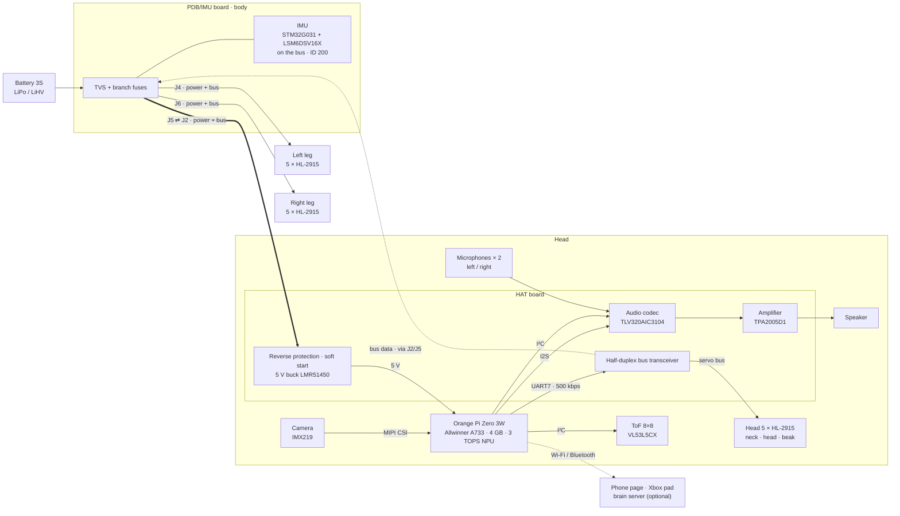
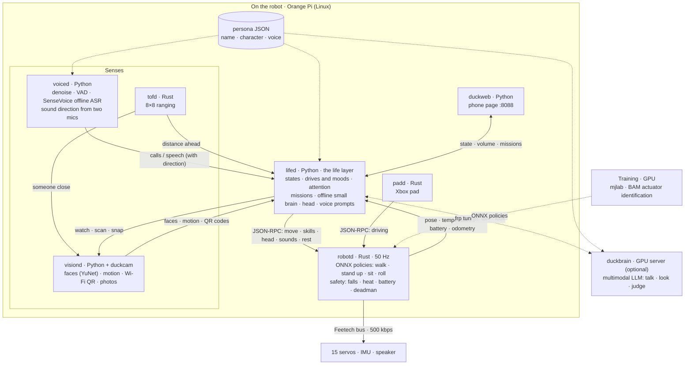

# DuckBuddy

*A little biped duck that walks on reinforcement-learning policies and has a life of its own — built on
[Pollen Robotics' Microduck](https://github.com/pollen-robotics/microduck), re-engineered around
low-cost Feetech servos and an Orange Pi Zero 3W.*

[中文](README.md)

https://github.com/user-attachments/assets/7dd5c290-7b48-4f87-a991-7aab6c25632f

*Spoken instructions, and it does the moves one after another (recorded 2026-10-17, with sound).*

The name says what it is: a little duck that is your buddy.

> DuckBuddy is an independent community project. It is **not** affiliated with or endorsed by Pollen
> Robotics; "Microduck" is their name for their robot. See [NOTICE](NOTICE).

## What it adds to Microduck

| | Microduck | DuckBuddy |
|---|---|---|
| Servos | 15 × Dynamixel XL330 (2S) | 15 × **Feetech HL-2915** (3S), HD-1910 (2S) on the way |
| Main board | Radxa Zero 3W (RK3566, 1 GB) | **Orange Pi Zero 3W** (Allwinner A733: 2×A76 + 6×A55, 4 GB, 3 TOPS NPU) |
| Carrier boards | Pollen's hat | our **HAT** (audio codec, two microphones, speaker amp, ToF, 5 V supply, servo bus) and **PDB/IMU** (power distribution, IMU on the servo bus) |
| Policies | Pollen's | **retrained for the HL-2915** (walk, stand up, sit/stand, forward roll) in `training/` |
| Behaviour | driven by a gamepad or the app | a **life layer** on the robot: drives, moods, rest and heat budgets, attention, voice, a mission planner — see `tools/lifed` |

Everything below runs **on the robot at once**, without a phone or the cloud:

- `robotd` — the 50 Hz control loop (Rust), now with a Feetech HLS bus driver, battery identification
  (2S/3S, LiPo/LiHV) and a thermal guard
- `voiced` — denoising, voice activity, offline speech recognition (SenseVoice) and the direction of a
  voice from the two head microphones
- `visiond` — camera: faces (YuNet) and motion for the attention, Wi-Fi provisioning by QR code
- `lifed` — the life layer: what the duck feels like doing, where it looks, what it says (in duck-speak)
- `duckweb` — a phone page: state, battery, conversation, volume
- optional: an online "brain" (`tools/duckbrain`, any OpenAI-compatible LLM, multimodal) for conversation

## Architecture

### Hardware

The battery feeds the PDB/IMU board in the body, which splits it into three branches, each carrying power
and the servo bus: left leg, right leg, head. The HAT sits on the Orange Pi in the head: it steps the battery
down to 5 V for the board, puts the board's UART on the servo bus, and does the sound (two microphones in,
a speaker out). The ToF and the camera are on the head too. All 15 servos and the IMU share one bus. Pinouts:
[docs/hardware/INTERFACE-CN.md](docs/hardware/INTERFACE-CN.md).

For developers: the same as an editable Mermaid diagram

### Software

Every service runs on the Orange Pi as its own process; they talk JSON over local Unix sockets.

- **robotd** is the only process that drives the servos: it runs the policies at 50 Hz and owns every
  safety guard.
- **lifed** is the mind: it gathers what voiced, visiond and tofd report, decides where to look, what to do
  and what to say, and sends intents to robotd. The gamepad (padd) sends intents to robotd too, and wins over
  lifed.
- Online, lifed asks the brain server through an frp tunnel; offline, its built-in small brain answers.

For developers: the same as an editable Mermaid diagram

## Progress

| When | Done |
|---|---|
| 2026-08 | Started from Microduck |
| 2026-09 | Designed the HAT (R3E) and PDB/IMU (R2f) boards; fabricated and assembled |
| early 2026-10 | Feetech HL-2915 bus driver, IMU firmware; actuator identification (BAM); walk, stand-up and sit/stand retrained |
| 10-13 | Xbox gamepad over Bluetooth |
| 10-14 | The life layer: drives, moods, rest, servo heat budget |
| 10-15 – 16 | Voice: offline recognition, duck-speak replies, online brain |
| 10-17 | Wi-Fi by QR code, voice prompts, volume, "what is this?", missions (a spoken sequence of moves), odometry calibration |
| 10-18 | Sound direction from two microphones, attention with vision (faces, motion), battery identification, persona apart from framework, open source |

| Area | What | Status |
|---|---|---|
| Skills | Forward roll, picking a cloth up from the floor (trained in sim, robot test next) | 🚧 in progress |
| Attention | Vision-guided gaze, on the robot | 🚧 in progress |
| Missions | Walking a spoken route on the robot | 🚧 in progress |
| 2S version | HD-1910 servos on 2S (boards being assembled, driver and retraining to do) | 🚧 in progress |
| NPU | Object detection for the attention | 📋 planned |
| On-device VLM | MiniCPM-V 4.7 1B, seeing offline | 📋 planned |
| Localisation | AprilTag landmarks → visual odometry → a room map | 📋 planned |
| Voice | Wake word, noisy rooms, two-mic beamforming | 📋 planned |
| Docs | English translations | 📋 planned |

## Make it your own duck

Who the duck is — its name, its character, how it talks — is one JSON file, apart from the code:
[`tools/persona`](tools/persona/README.md). The repo ships an example duck; write your own.

## Hardware

- **Mechanics** are Microduck's: the original printed parts fit the HL-2915 as is (same outline, holes and
  output shaft). Our head is reworked — the face carries a ToF and an IMX219 camera, the shell has cooling
  vents and two microphone holes; the print project is in [hardware/print](hardware/print/README.md).
- **Carrier boards**: two boards of our own, the HAT and the PDB/IMU. Their interfaces — pinouts, power, bus — are documented in
  [docs/hardware/INTERFACE-CN.md](docs/hardware/INTERFACE-CN.md). The board design files are not part
  of this repository; assembled boards are available from the maintainer, or design your own to the
  interface.

- The original Microduck hardware (Radxa + Dynamixel) still works with the software: the Dynamixel
  bus driver is unchanged.

## Repository

| Path | What |
|---|---|
| `robotd`, `duck-control`, `kinematics`, `padd`, `robotctl`, … | the Rust workspace (from Microduck, extended) |
| `tools/` | the Python services: `lifed`, `voiced`, `visiond`, `duckweb`, `duckbrain`, `persona`, robot test scripts |
| `firmware/imu-feetech` | the IMU board's firmware (STM32G031 + LSM6DSV16X, speaks the Feetech protocol) |
| `training/` | HL-2915 tasks, actuator identification (BAM), evaluation scripts, trained policies (`training/policies`) |
| `hardware/rev-a/mjcf` | the robot model used for training |
| `docs/` | the hardware interface (`docs/hardware`), and Microduck's own design notes and guides |

## Contributing

Issues and pull requests are welcome. Good places to start: the HD-1910 servo driver, NPU object detection
for the attention, AprilTag localisation for the mission planner, English translations of the docs. See
[CONTRIBUTING.md](CONTRIBUTING.md) for building and testing.

## License

Software: Apache-2.0 (as Microduck). Documentation: CC-BY-4.0. Some components carry their own licences —
see [NOTICE](NOTICE).
