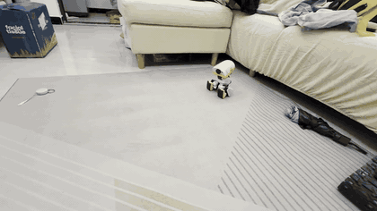
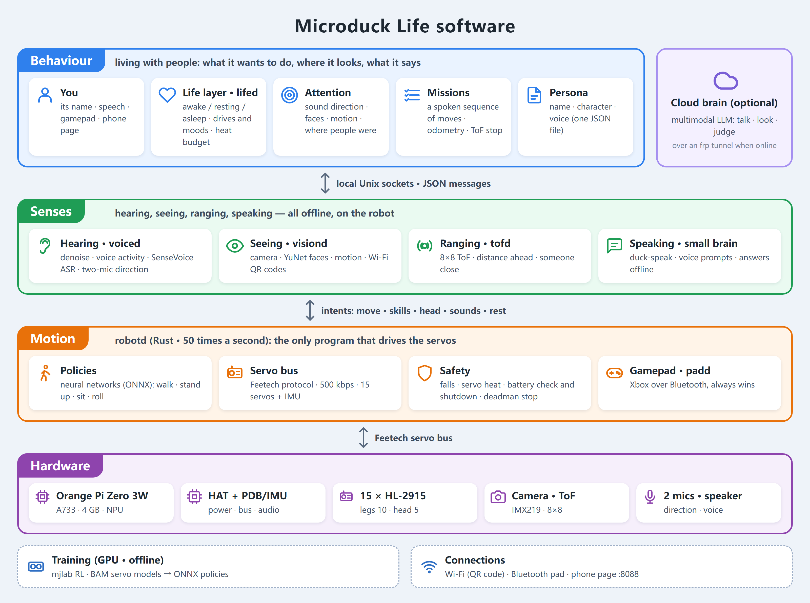
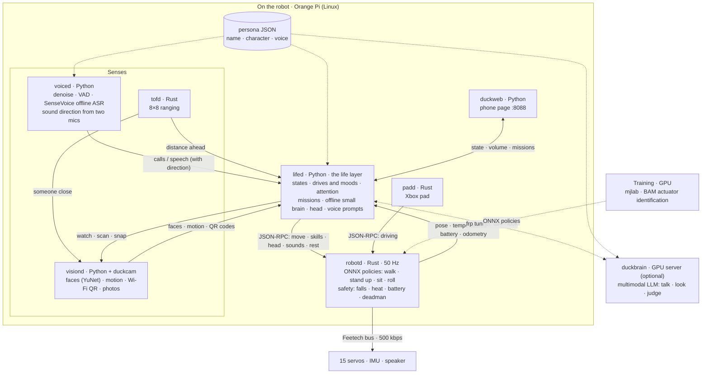
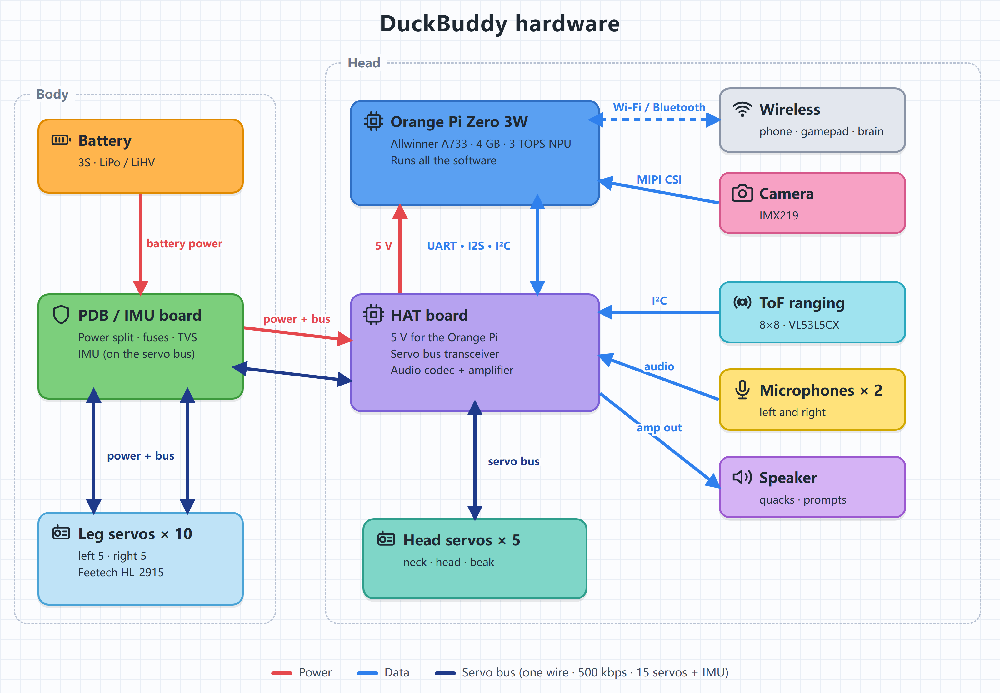
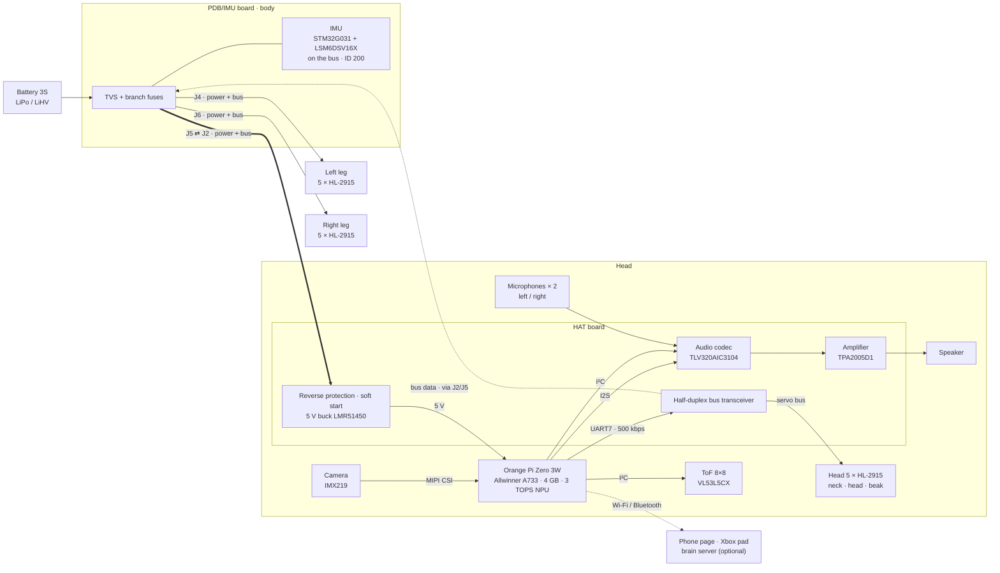
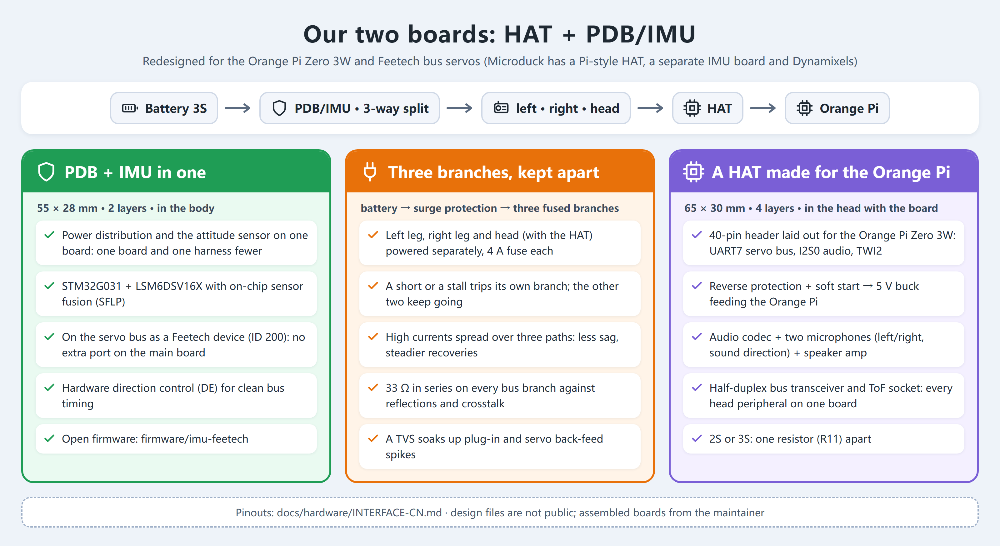

<h1 align="center">DuckBuddy</h1>

<b>An open-source embodied AI robot duck — it walks, hears, sees, and has a life of its own.</b>

🦆 <b>Make DuckBuddy your real-life buddy duck.</b> <i>让 DuckBuddy 成为你真正的生活伙伴鸭。</i>

<a href="README.md">中文</a> | English

https://github.com/user-attachments/assets/7dd5c290-7b48-4f87-a991-7aab6c25632f

A string of spoken instructions, done one move after another (recorded on the robot, 2026-10-17; it has sound — unmute the player).

📱 No video in the GitHub app? Open the GIF

3× speed, no sound. The full video: <a href="https://github.com/Animan-AI/DuckBuddy/raw/main/docs/media/demo.mp4">download demo.mp4</a> (5.7 MB), or open this page in a browser.

This is not just another robot duck. DuckBuddy brings **motion, perception, voice and a life layer** together
in one open system that you can **build and improve** — and all of it runs on the robot itself, without a
phone or the cloud.

DuckBuddy is built on [Pollen Robotics' Microduck](https://github.com/pollen-robotics/microduck). It is an independent community project, **not** affiliated with or endorsed by Pollen Robotics; "Microduck" is their name for their robot. See [NOTICE](NOTICE).

## What makes DuckBuddy special?

- 🦆 **Motion** — Reinforcement-learning policies retrained for our Feetech HL-2915 servos: walking, getting up after a fall, sitting down and standing up, a forward roll (trained in sim). A 50 Hz loop that guards against falls, heat, a flat battery and a lost link
- 👂 **Hearing** — Offline speech recognition (SenseVoice) with denoising and voice detection; two microphones in the head tell which side a voice came from, so it turns to look when you call it
- 👀 **Vision** — Notices faces and things that move and turns to look, naturally (being tested on the robot); joins Wi-Fi from a QR code; "what is this?" answered by a multimodal model when online
- 🧭 **Autonomy** — A mission layer: say a string of moves ("two steps forward, turn around, sit down") and it plans and does them in turn; walking a spoken route is being tested on the robot
- 💗 **A life layer** — Drives and moods; it tires, rests and keeps its servos cool (a hot head moves less); it answers in duck-speak rather than a text-to-speech voice; its name and character live in one persona file — swap it and you have a different duck

## Architecture

One picture of how it fits together: **perception** (hearing, vision, distance) reports events to the
**life layer**, `lifed`, which decides where to look, what to do and what to say, and hands its intents to
**robotd**, the only process that drives the servos. The gamepad outranks `lifed`. Online, `lifed` asks a
**brain server** (a multimodal LLM) through an frp tunnel; offline, its own small brain answers. Every
service runs on its own on the Orange Pi and they talk JSON over local Unix sockets.

For developers: the editable Mermaid diagram

## Hardware & Software

### Hardware at a glance

| | Microduck | DuckBuddy |
|---|---|---|
| Main board | Radxa Zero 3W (RK3566, 1 GB) | **Orange Pi Zero 3W** (Allwinner A733: 2×A76 + 6×A55, 4 GB, 3 TOPS NPU) |
| Servos | 15 × Dynamixel XL330 (2S) | 15 × **Feetech HL-2915** (3S); HD-1910 (2S) on the way |
| Carrier boards | Pollen's hat | our **HAT** (audio codec, two microphones, speaker amp, ToF, 5 V supply, servo bus) and **PDB/IMU** (power distribution + an IMU on the servo bus) |
| Sensors | IMU | IMU, two microphones, IMX219 camera, 8×8 ToF ranging |
| Policies | Pollen's | **retrained for the HL-2915**, in `training/` |
| Behaviour | a gamepad or the app | a **life layer** on the robot, in `tools/lifed` |

The battery plugs into the PDB/IMU board in the body, which splits it three ways — left leg, right leg,
head — each branch carrying power and the servo bus. The HAT sits on the Orange Pi in the head: it brings
the battery down to 5 V for the Orange Pi, puts its UART on the servo bus, and does the sound (two
microphones in, a speaker out). The 15 servos and the IMU share one bus.

For developers: the editable Mermaid diagram

Our two boards, the HAT and the PDB/IMU:

### Software stack

| Service | Language | What it does |
|---|---|---|
| `robotd` | Rust | the 50 Hz control loop running ONNX policies; Feetech HLS bus driver, battery identification (2S/3S, LiPo/LiHV), heat and fall guards |
| `lifed` | Python | the life layer: state machine, drives and moods, attention, missions, an offline small brain, head motion |
| `voiced` | Python | denoising, voice detection, offline recognition (SenseVoice), sound direction from two microphones |
| `visiond` | Python | the camera: faces (YuNet), motion, Wi-Fi by QR code, snapshots |
| `tofd` | Rust | 8×8 ToF ranging: distance ahead, someone close |
| `padd` | Rust | Xbox gamepad over Bluetooth; outranks `lifed` |
| `duckweb` | Python | a phone page: state, battery, conversation, volume |
| `duckbrain` | Python | optional, on a GPU server: any OpenAI-compatible multimodal LLM, for conversation and looking |
| `persona` | JSON | who the duck is — name, character, how it talks — apart from the code |

### Verified platforms

| Combination | Status |
|---|---|
| Orange Pi Zero 3W 4 GB + 15 × HL-2915 + 3S battery (LiPo 1500 mAh / LiHV 2800 mAh) | ✅ in daily use |
| Orange Pi Zero 3W + 15 × HD-1910 + 2S battery | 🚧 boards being assembled; servo driver and policies to do |
| Original Microduck (Radxa Zero 3W + Dynamixel XL330) | ⚪ the Dynamixel bus driver is unchanged; not tested by us |

### Progress

| When | Done |
|---|---|
| 2026-08 | Started from Microduck |
| 2026-09 | Designed the HAT (R3E) and PDB/IMU (R2f) boards; fabricated and assembled |
| early 2026-10 | Feetech HL-2915 bus driver, IMU firmware; actuator identification (BAM); walk, stand-up and sit/stand retrained |
| 10-13 | Xbox gamepad over Bluetooth |
| 10-14 | The life layer: drives, moods, rest, servo heat budget |
| 10-15 – 16 | Voice: offline recognition, duck-speak replies, online brain |
| 10-17 | Wi-Fi by QR code, voice prompts, volume, "what is this?", missions (a spoken sequence of moves), odometry calibration |
| 10-18 | Sound direction from two microphones, attention with vision (faces, motion), battery identification, persona apart from framework, open source |

| Area | What | Status |
|---|---|---|
| Skills | Forward roll, picking a cloth up from the floor (trained in sim, robot test next) | 🚧 in progress |
| Attention | Vision-guided gaze, on the robot | 🚧 in progress |
| Missions | Walking a spoken route on the robot | 🚧 in progress |
| 2S version | HD-1910 servos on 2S | 🚧 in progress |
| NPU | Object detection for the attention | 📋 planned |
| On-device VLM | MiniCPM-V 4.7 1B, seeing offline | 📋 planned |
| Localisation | AprilTag landmarks → visual odometry → a room map | 📋 planned |
| Voice | Wake word, noisy rooms, two-mic beamforming | 📋 planned |
| Docs | English translations, a full build guide | 📋 planned |

## Build Your Own DuckBuddy

| Step | Where | Status |
|---|---|---|
| 1. Get the parts | the parts list below | ✅ list · 🚧 shop links coming |
| 2. Print | [hardware/print](hardware/print/README.md): Bambu Studio project `DuckBuddy.3mf`, 6 plates, PETG + TPU, settings included | ✅ |
| 3. Carrier boards | interfaces (pinouts, power, bus): [docs/hardware/INTERFACE-CN.md](docs/hardware/INTERFACE-CN.md). The PCB design files are not public; assembled boards are available from the maintainer, or design your own to the interface | ✅ interface |
| 4. Flash the IMU | [firmware/imu-feetech](firmware/imu-feetech/README.md): ST-Link on the PDB's J2, one `probe-rs` command | ✅ |
| 5. Set up the Orange Pi | services in [deploy/opi-dev](deploy/opi-dev/README.md), robot configs in [deploy/robots](deploy/robots) | 🚧 one-step installer coming |
| 6. Policies | trained policies ship in the repo; to train your own see [training](training) | ✅ |
| 7. Give it a character | [tools/persona](tools/persona/README.md): write your own persona JSON after the example duck | ✅ |
| 8. Assembly guide, FAQ | a short FAQ below; an illustrated assembly guide is coming | 🚧 |

### Parts list

| Part | Qty | Notes |
|---|---|---|
| Feetech HL-2915 servo | 15 | the 3S version; 2 × 5 in the legs, 5 in the head (neck, head, beak). Microduck's printed parts fit as is, M2×6 self-tapping screws |
| Orange Pi Zero 3W | 1 | the 4 GB version recommended |
| HAT | 1 | in the head, stacked on the Orange Pi |
| PDB/IMU board | 1 | in the body |
| IMX219 camera module | 1 | MIPI CSI, in the face |
| 8×8 ToF module (VL53L5CX) | 1 | in the face |
| Small speaker | 1 | on the HAT's amplifier |
| 3S battery | 1 | LiPo 1500 mAh or LiHV 2800 mAh; robotd identifies it |
| PETG and TPU filament | | TPU for the soft parts (soles, beak) |
| Xbox gamepad | 1 | optional, Bluetooth |

### FAQ

- **2S or 3S?** The HL-2915 runs on 3S. The HD-1910 runs on 2S, and the HAT needs one resistor changed
  (R11); nothing else. robotd identifies the pack at start-up and refuses to power the servos if it does
  not match the configuration.
- **The servos have power but don't move?** Feetech HLS servos stay still while their target current and
  running speed registers are 0. robotd writes them at start-up; set them in your own test scripts.
- **It stops answering the stick after a while?** Most likely the head servos' heat guard. The head has
  little cooling, and the life layer budgets its movement and rest by temperature.
- **Does the original Microduck run this software?** In software terms yes — the Dynamixel bus driver is
  unchanged — but we have not tested it on the original hardware.

## Join the Community

[Issues](https://github.com/Animan-AI/DuckBuddy/issues) and pull requests are welcome; see
[CONTRIBUTING.md](CONTRIBUTING.md) for building and testing. Places we'd love help with:

- the HD-1910 servo driver;
- NPU object detection for the attention;
- AprilTag localisation for the mission layer;
- the build guide and English translations of the docs.

Repository layout

| Path | What |
|---|---|
| `robotd`, `duck-control`, `kinematics`, `padd`, `robotctl`, … | the Rust workspace (from Microduck, extended) |
| `tools/` | the Python services: `lifed`, `voiced`, `visiond`, `duckweb`, `duckbrain`, `persona`, robot test scripts |
| `firmware/imu-feetech` | the IMU board's firmware (STM32G031 + LSM6DSV16X, speaks the Feetech protocol) |
| `training/` | HL-2915 tasks, actuator identification (BAM), evaluation scripts, trained policies |
| `hardware/` | the print project (`hardware/print`), the robot model used for training (`hardware/rev-a/mjcf`) |
| `docs/` | the hardware interface (`docs/hardware`), and Microduck's own design notes and guides |

Come and chat — building, tuning, training, or just showing off your duck. The WeChat group:

WeChat group codes expire after a week and are refreshed here; if this one has lapsed, open an issue.

---

License: software Apache-2.0 (as Microduck), documentation CC-BY-4.0; some components carry their own licences — see [NOTICE](NOTICE).
