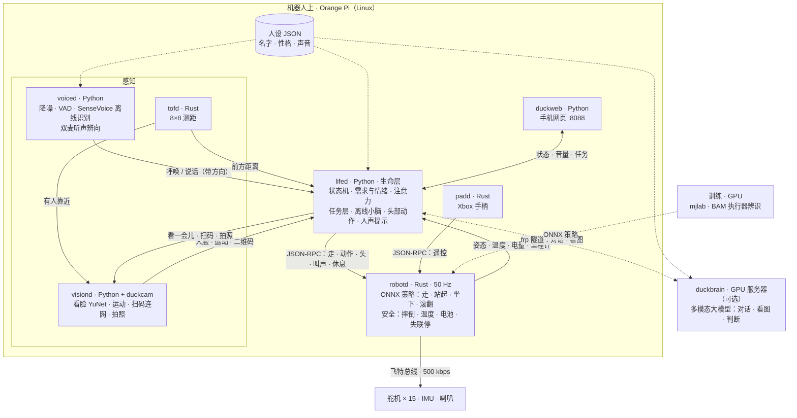
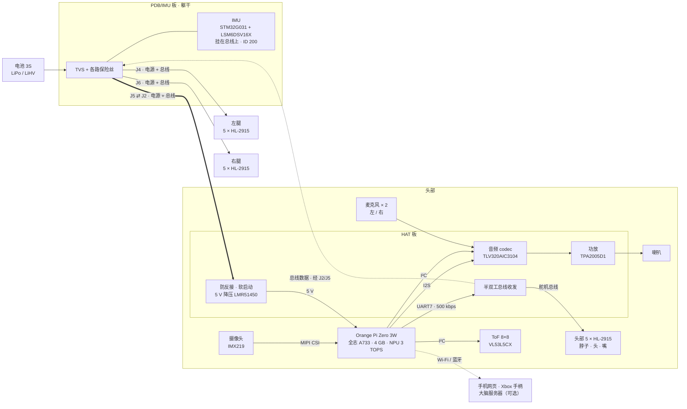

<h1 align="center">DuckBuddy</h1>

<b>An open-source embodied AI robot duck — it walks, hears, sees, and has a life of its own.</b>

一只基于开源硬件、能走能跑，并逐步融合语音、视觉和自主行为的小型具身智能机器人。

🦆 <b>让 DuckBuddy 成为你真正的生活伙伴鸭。</b> <i>Your real-life buddy duck.</i>

中文 | <a href="README-EN.md">English</a>

https://github.com/user-attachments/assets/7dd5c290-7b48-4f87-a991-7aab6c25632f

用语音说一串指令，它连续完成几个动作（2026-10-17 实机录制，有声音，点开后取消静音）。

📱 在 GitHub App 里看不到视频？点这里看动图

3 倍速动图，没有声音。完整视频：<a href="https://github.com/Animan-AI/DuckBuddy/raw/main/docs/media/demo.mp4">下载 demo.mp4</a>（5.7 MB），或用浏览器打开本页。

我们想做的不只是"又一只机器鸭"，而是把**运动、环境感知、语音交互和生命层**整合成一个**可复刻、可改进**的开源系统：全部跑在机器人自己身上，不依赖手机或云端。

DuckBuddy 基于 [Pollen Robotics 的 Microduck](https://github.com/pollen-robotics/microduck)，是独立的社区项目，**不隶属于 Pollen Robotics，也未获其背书**，详见 [NOTICE](NOTICE)。

## What makes DuckBuddy special? · 它特别在哪

- 🦆 **运动**：强化学习策略按我们的飞特 HL-2915 舵机重新训练，会走路、摔倒后站起、坐下/站起、前滚翻（仿真已训好）；50 Hz 控制，摔倒、过热、低电量、失联都会自动保护
- 👂 **声音感知**：离线语音识别（SenseVoice），降噪和人声检测；头上两个麦克风判断声音从哪边来，叫它一声会转头看你
- 👀 **视觉**：看人脸、注意到动的东西，自然地转头去看（实机验证中）；扫二维码连 WiFi；"看看这是什么"（联网时由多模态大模型回答）
- 🧭 **自主行为**：说一串动作（"往前走两步，转个身，再坐下"），它拆成步骤连续执行；按说出的路线行走正在实机测试
- 💗 **生命层**：有需求和情绪，会累、会休息，会管理舵机温度（头热了就少动）；用"鸭语"回应，而不是机器朗读；名字和性格写在一个人设文件里，换一份就是另一只鸭子

## Architecture · 系统架构

一张图看懂各部分怎么配合：**感知**（声音、视觉、距离）把事件交给**生命层** lifed，lifed 决定看哪里、做什么、说什么，再把意图交给唯一直接驱动舵机的 **robotd**；手柄的优先级高于 lifed；联网时，lifed 通过 frp 隧道向**大脑服务器**（多模态大模型）提问，离线时由自带的"小脑"回答。所有服务都在 Orange Pi 上独立运行，通过本机 Unix socket 交换 JSON 消息。

开发者版：可编辑的 Mermaid 图

## Hardware & Software · 软硬件

### 硬件一览

|  | Microduck 原版 | DuckBuddy |
|---|---|---|
| 主控 | Radxa Zero 3W（RK3566，1 GB） | **Orange Pi Zero 3W**（全志 A733：2×A76 + 6×A55，4 GB，3 TOPS NPU） |
| 舵机 | 15 × Dynamixel XL330（2S） | 15 × **飞特 HL-2915**（3S）；HD-1910（2S）在做 |
| 扩展板 | Pollen 的 HAT | 我们的 **HAT**（音频 codec、双麦、喇叭功放、ToF、5 V 电源、舵机总线）和 **PDB/IMU**（配电 + 挂在舵机总线上的 IMU） |
| 传感器 | IMU | IMU、双麦克风、IMX219 摄像头、8×8 ToF 测距 |
| 策略 | Pollen 的 | 按 HL-2915 **重新训练**，见 `training/` |
| 行为 | 手柄或 App 控制 | 机器人上的**生命层**，见 `tools/lifed` |

电池接在躯干里的 PDB/IMU 板上，分三路供电，每路都带电源和舵机总线：左腿、右腿、头部。HAT 和 Orange Pi 叠在一起装在头里：HAT 把电池电压降成 5 V 给 Orange Pi，把串口接到舵机总线上，并负责声音（两个麦克风进、一个喇叭出）。15 个舵机和 IMU 共用同一条总线。

开发者版：可编辑的 Mermaid 图

我们自己设计的两块板，HAT 和 PDB/IMU：

### 软件栈

| 服务 | 语言 | 做什么 |
|---|---|---|
| `robotd` | Rust | 50 Hz 控制环，跑 ONNX 策略；飞特 HLS 总线驱动、电池识别（2S/3S、LiPo/LiHV）、温度和摔倒保护 |
| `lifed` | Python | 生命层：状态机、需求与情绪、注意力、任务层、离线小脑、头部动作 |
| `voiced` | Python | 降噪、人声检测、离线识别（SenseVoice）、双麦听声辨向 |
| `visiond` | Python | 摄像头：人脸（YuNet）、运动检测、扫码连网、拍照 |
| `tofd` | Rust | 8×8 ToF 测距：前方距离、有人靠近 |
| `padd` | Rust | Xbox 手柄（蓝牙），优先级高于 lifed |
| `duckweb` | Python | 手机网页：状态、电量、对话、音量 |
| `duckbrain` | Python | 可选，跑在 GPU 服务器上：任何兼容 OpenAI 接口的多模态大模型，负责聊天和看图 |
| `persona` | JSON | 人设：名字、性格、说话方式，和代码分开 |

### 已验证的平台

| 组合 | 状态 |
|---|---|
| Orange Pi Zero 3W 4 GB + 15 × HL-2915 + 3S 电池（LiPo 1500 mAh / LiHV 2800 mAh） | ✅ 整机日常运行 |
| Orange Pi Zero 3W + 15 × HD-1910 + 2S 电池 | 🚧 板子在焊，舵机驱动和策略待做 |
| Microduck 原版（Radxa Zero 3W + Dynamixel XL330） | ⚪ Dynamixel 总线驱动未改动，我们没有实机测过 |

### 开发进度

| 时间 | 完成的事 |
|---|---|
| 2026-08 | 基于 Microduck 起步，整理原版硬件和软件 |
| 2026-09 | 设计 HAT（R3E）和 PDB/IMU（R2f），打板、焊接 |
| 2026-10 上旬 | 飞特 HL-2915 舵机驱动、IMU 固件；执行器辨识（BAM），重新训练走路、站起、坐下策略 |
| 10-13 | Xbox 手柄（蓝牙） |
| 10-14 | 生命层：需求、情绪、休息、舵机散热预算 |
| 10-15 ~ 16 | 语音：离线识别、用鸭语表达、联网大脑对话 |
| 10-17 | 扫二维码连 WiFi、人声提示、音量、"看看这是什么"、任务层（说一串动作连续执行）、里程计标定 |
| 10-18 | 双麦听声辨向、注意力与视觉引导（人脸、运动）、电池自动识别（2S/3S、LiPo/LiHV）、人设与框架分离、开源 |

| 方向 | 内容 | 状态 |
|---|---|---|
| 新技能 | 前滚翻、叼起地上的衣服（仿真里已训练好，待实机测试） | 🚧 进行中 |
| 注意力 | 视觉引导转头的实机验证 | 🚧 进行中 |
| 任务 | 实机按说出的路线行走 | 🚧 进行中 |
| 2S 版 | HD-1910 舵机 + 2S 电池 | 🚧 进行中 |
| NPU | 物体检测，接进注意力 | 📋 计划 |
| 端侧多模态 | MiniCPM-V 4.7 1B，离线也能"看"东西 | 📋 计划 |
| 定位 | AprilTag 地标 → 视觉里程计 → 房间级地图 | 📋 计划 |
| 语音 | 唤醒词、嘈杂环境、双麦波束 | 📋 计划 |
| 文档 | 英文翻译、完整装机教程 | 📋 计划 |

## Build Your Own DuckBuddy · 做一只你自己的鸭子

| 步骤 | 资料 | 状态 |
|---|---|---|
| 1. 准备零件 | 见下方零件清单 | ✅ 清单 · 🚧 购买链接整理中 |
| 2. 3D 打印 | [hardware/print](hardware/print/README.md)：拓竹工程 `microduck2.3mf`，9 个打印盘，PETG + TPU，参数已设好 | ✅ |
| 3. 扩展板 | 接口（引脚、电源、总线）：[docs/hardware/INTERFACE-CN.md](docs/hardware/INTERFACE-CN.md)。PCB 设计文件不公开；可以向维护者购买焊好的板（进群联系），也可以按接口自己设计 | ✅ 接口 |
| 4. 烧录 IMU 固件 | [firmware/imu-feetech](firmware/imu-feetech/README.md)：ST-Link 接 PDB 的 J2，`probe-rs` 一条命令烧录 | ✅ |
| 5. 装主控系统和服务 | 服务配置见 [deploy/opi-dev](deploy/opi-dev/README.md)、机器人配置见 [deploy/robots](deploy/robots) | 🚧 一键安装脚本整理中 |
| 6. 策略 | 训练好的策略在仓库里，可以直接用；自己训练见 [training](training) | ✅ |
| 7. 给它一个性格 | [tools/persona](tools/persona/README.md)：照着示例鸭子写你自己的人设 JSON | ✅ |
| 8. 组装教程、常见问题 | 下方先列了常见问题；图文组装教程整理中 | 🚧 |

### 零件清单

| 零件 | 数量 | 说明 |
|---|---|---|
| 飞特 HL-2915 舵机 | 15 | 3S 版；腿 2 × 5，头部 5（脖子、头、嘴）。原版打印件直接装，M2×6 自攻螺丝 |
| Orange Pi Zero 3W | 1 | 建议 4 GB 版本 |
| HAT 扩展板 | 1 | 装在头里，和 Orange Pi 叠装 |
| PDB/IMU 板 | 1 | 装在躯干里 |
| IMX219 摄像头模组 | 1 | MIPI CSI，装在前脸 |
| 8×8 ToF 模块（VL53L5CX） | 1 | 装在前脸 |
| 小喇叭 | 1 | 接 HAT 的功放 |
| 3S 电池 | 1 | LiPo 1500 mAh 或 LiHV 2800 mAh，robotd 会自动识别 |
| PETG、TPU 耗材 | 适量 | TPU 用于脚底、软嘴等软零件 |
| Xbox 手柄 | 1 | 可选，蓝牙遥控 |

### 常见问题

- **2S 还是 3S？** HL-2915 用 3S。HD-1910 用 2S，HAT 只需换一颗电阻（R11），其它通用。robotd 开机时会识别电池节数和类型，和配置不符就拒绝上电。
- **舵机通电了但不动？** 飞特 HLS 舵机的"目标电流"和"运行速度"为 0 时不会动。robotd 启动时会自动写好，自己写测试脚本时要记得设置。
- **走一会儿就不听摇杆了？** 多半是头部舵机过热保护。头里散热有限，生命层会按温度预算让它少动、多休息。
- **原版 Microduck 能用这套软件吗？** 软件上兼容，Dynamixel 总线驱动没有改动，但我们没有在原版硬件上实测过。

## Join the Community · 加入我们

欢迎提 [Issue](https://github.com/Animan-AI/DuckBuddy/issues) 和 Pull Request，编译和测试见 [CONTRIBUTING.md](CONTRIBUTING.md)。特别欢迎一起做的方向：

- HD-1910 舵机驱动；
- 用 NPU 做物体检测，接进注意力模块；
- 用 AprilTag 给任务层做定位；
- 装机教程和英文翻译。

仓库结构

| 路径 | 内容 |
|---|---|
| `robotd`、`duck-control`、`kinematics`、`padd`、`robotctl` 等 | Rust 工作区（来自 Microduck，有扩展） |
| `tools/` | Python 服务：`lifed`、`voiced`、`visiond`、`duckweb`、`duckbrain`、`persona`，以及实机测试脚本 |
| `firmware/imu-feetech` | IMU 板固件（STM32G031 + LSM6DSV16X，走飞特协议） |
| `training/` | HL-2915 训练任务、执行器辨识（BAM）、评测脚本、训练好的策略 |
| `hardware/` | 打印工程（`hardware/print`）、训练用的机器人模型（`hardware/rev-a/mjcf`） |
| `docs/` | 硬件接口（`docs/hardware`），以及 Microduck 原有的设计文档和使用说明 |

玩法、组装、调试、训练，都欢迎进群聊。微信扫码加入：

群二维码每周更新；过期了请提 Issue，我们会尽快换新的。

---

许可证：软件 Apache-2.0（与 Microduck 相同），文档 CC-BY-4.0；部分组件有各自的许可证，见 [NOTICE](NOTICE)。
