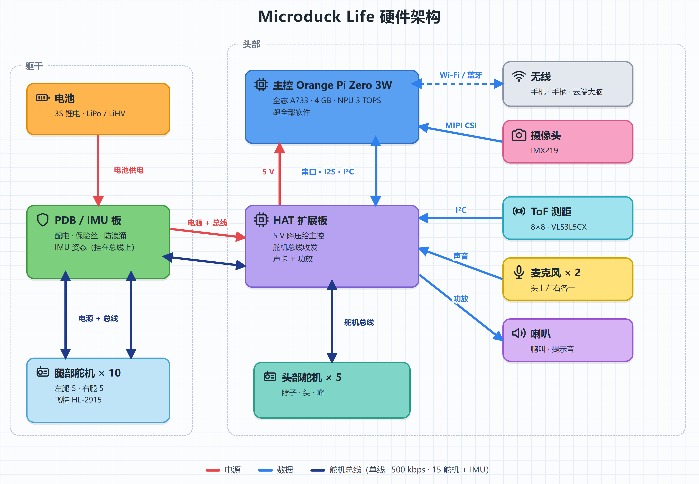
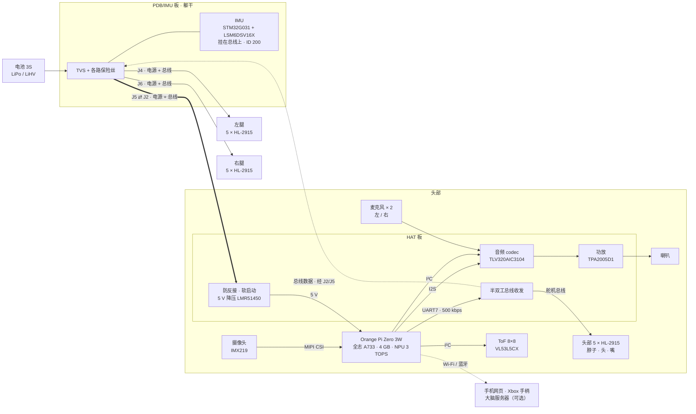
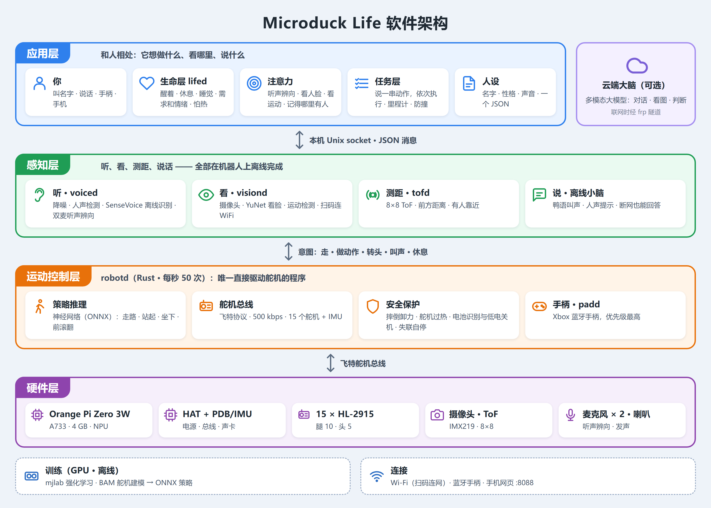
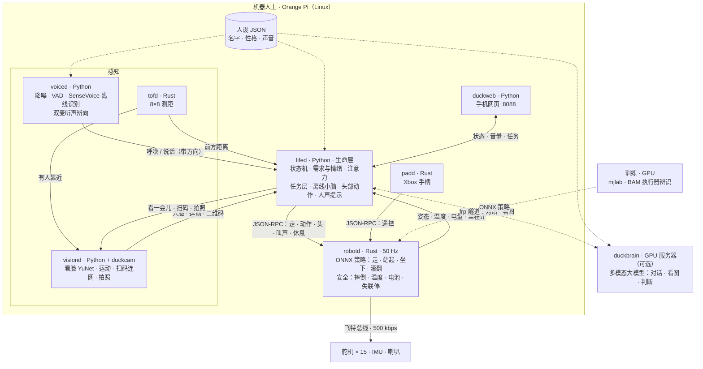
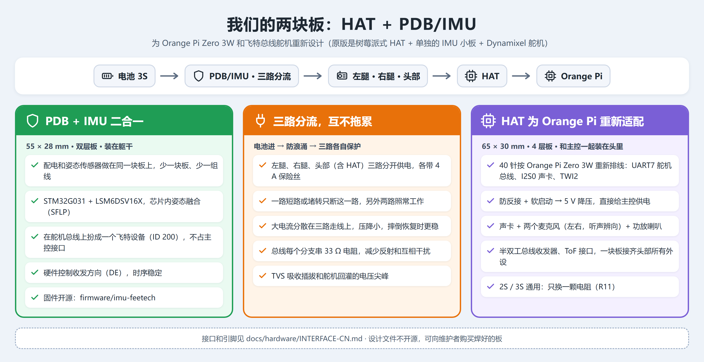

# Microduck Life（鸭生）

*一只靠强化学习策略走路、有自己"生活"的小两足鸭子。基于 [Pollen Robotics 的 Microduck](https://github.com/pollen-robotics/microduck)，改用低成本的飞特舵机和 Orange Pi Zero 3W。*

[English](README-EN.md)

https://github.com/user-attachments/assets/7dd5c290-7b48-4f87-a991-7aab6c25632f

*用语音说一串指令，它连续完成几个动作（2026-10-17 录，有声音）。*

名字的意思是：这是给 Microduck 做的，让它有自己的"生活"。

> Microduck Life 是独立的社区项目，**不隶属于 Pollen Robotics，也未获其背书**。"Microduck" 是他们给自己机器人起的名字。详见 [NOTICE](NOTICE)。

## 相对 Microduck 的改动

|  | Microduck | Microduck Life |
|---|---|---|
| 舵机 | 15 × Dynamixel XL330（2S） | 15 × **飞特 HL-2915**（3S）；HD-1910（2S）在做 |
| 主控 | Radxa Zero 3W（RK3566，1 GB） | **Orange Pi Zero 3W**（全志 A733：2×A76 + 6×A55，4 GB，3 TOPS NPU） |
| 扩展板 | Pollen 的 HAT | 我们的 **HAT**（音频 codec、双麦、喇叭功放、ToF、5 V 电源、舵机总线）和 **PDB/IMU**（配电、挂在舵机总线上的 IMU） |
| 策略 | Pollen 的 | 按 HL-2915 **重新训练**（走路、站起、坐下/站起、前滚翻），见 `training/` |
| 行为 | 手柄或 App 控制 | 机器人上的**生命层**：需求、情绪、休息和散热预算、注意力、语音、任务规划，见 `tools/lifed` |

下面这些都在**机器人上同时运行**，不依赖手机或云端：

- `robotd`：50 Hz 控制环（Rust）。加了飞特 HLS 总线驱动、电池识别（2S/3S、LiPo/LiHV）和舵机温度保护。
- `voiced`：降噪、人声检测、离线语音识别（SenseVoice），用头上两个麦克风判断声音方向。
- `visiond`：摄像头。看脸（YuNet）和运动检测供注意力使用，扫二维码连 WiFi。
- `lifed`：生命层。鸭子想做什么、看哪里、说什么（用鸭语说）。
- `duckweb`：手机网页，显示状态、电量、对话，调音量。
- 可选：联网的"大脑"（`tools/duckbrain`，任何兼容 OpenAI 接口的多模态大模型），用来聊天。

## 架构

### 硬件

电池接在躯干里的 PDB/IMU 板上，从这里分三路，每路都带电源和舵机总线：左腿、右腿、头部。HAT 和 Orange Pi 叠在一起，装在头里：HAT 把电池电压降成 5 V 给 Orange Pi，把 Orange Pi 的串口接到舵机总线上，并负责声音（两个麦克风进、一个喇叭出）。ToF 和摄像头也在头上。15 个舵机和 IMU 共用同一条总线。引脚细节见 [docs/hardware/INTERFACE-CN.md](docs/hardware/INTERFACE-CN.md)。

开发者版：可编辑的 Mermaid 图

### 软件

所有服务都在 Orange Pi 上，各自独立运行，通过本机 Unix socket 交换 JSON 消息：

- **robotd** 是唯一直接动舵机的进程，以 50 Hz 跑策略，负责一切安全保护。
- **lifed** 是"想法"：收集 voiced、visiond、tofd 报来的事件，决定看哪里、做什么、说什么，再把意图发给 robotd。手柄（padd）也是发意图给 robotd，并且优先于 lifed。
- 联网时，lifed 通过 frp 隧道向大脑服务器提问；离线时由它自带的"小脑"回答。

开发者版：可编辑的 Mermaid 图

## 开发进度

| 时间 | 完成的事 |
|---|---|
| 2026-08 | 基于 Microduck 起步，整理原版硬件和软件 |
| 2026-09 | 设计 HAT（R3E）和 PDB/IMU（R2f），打板、焊接 |
| 2026-10 上旬 | 飞特 HL-2915 舵机驱动、IMU 固件；执行器辨识（BAM），重新训练走路、站起、坐下策略 |
| 10-13 | Xbox 手柄（蓝牙） |
| 10-14 | 生命层：需求、情绪、休息、舵机散热预算 |
| 10-15 ~ 16 | 语音：离线识别、用鸭语表达、联网大脑对话 |
| 10-17 | 扫二维码连 WiFi、人声提示、音量、"看看这是什么"、任务层（说一串动作连续执行）、里程计标定 |
| 10-18 | 双麦听声辨向、注意力与视觉引导（人脸、运动）、电池自动识别（2S/3S、LiPo/LiHV）、人设与框架分离、开源 |

| 方向 | 内容 | 状态 |
|---|---|---|
| 新技能 | 前滚翻、叼起地上的衣服（仿真里已训练好，待实机测试） | 🚧 进行中 |
| 注意力 | 视觉引导转头的实机验证 | 🚧 进行中 |
| 任务 | 实机按说出的路线行走 | 🚧 进行中 |
| 2S 版 | HD-1910 舵机 + 2S 电池（板子在焊，舵机驱动待写，策略要重训） | 🚧 进行中 |
| NPU | 物体检测，接进注意力 | 📋 计划 |
| 端侧多模态 | MiniCPM-V 4.7 1B，离线也能"看"东西 | 📋 计划 |
| 定位 | AprilTag 地标 → 视觉里程计 → 房间级地图 | 📋 计划 |
| 语音 | 唤醒词、嘈杂环境、双麦波束 | 📋 计划 |
| 文档 | 英文翻译 | 📋 计划 |

## 做一只你自己的鸭子

鸭子是谁（名字、性格、说话方式）放在一个 JSON 文件里，和代码分开，见 [`tools/persona`](tools/persona/README.md)。仓库里带了一只示例鸭子，照着写你自己的。

## 硬件

- **结构件**沿用 Microduck，原版打印件直接装 HL-2915（外形、孔位、输出轴都一样）。我们改过头部：前脸装 ToF 和 IMX219 摄像头，头壳加了散热孔和两个麦克风孔。整机打印工程见 [hardware/print](hardware/print/README.md)。
- **扩展板**：我们自己设计了两块板，HAT 和 PDB/IMU。接口（引脚、电源、总线）见 [docs/hardware/INTERFACE-CN.md](docs/hardware/INTERFACE-CN.md)。板子的设计文件不在本仓库；可以向维护者购买焊好的板，也可以按接口自己设计。

- 原版 Microduck 硬件（Radxa + Dynamixel）仍然能用这套软件，Dynamixel 总线驱动没有改动。

## 仓库结构

| 路径 | 内容 |
|---|---|
| `robotd`、`duck-control`、`kinematics`、`padd`、`robotctl` 等 | Rust 工作区（来自 Microduck，有扩展） |
| `tools/` | Python 服务：`lifed`、`voiced`、`visiond`、`duckweb`、`duckbrain`、`persona`，以及实机测试脚本 |
| `firmware/imu-feetech` | IMU 板固件（STM32G031 + LSM6DSV16X，走飞特协议） |
| `training/` | HL-2915 训练任务、执行器辨识（BAM）、评测脚本、训练好的策略（`training/policies`） |
| `hardware/rev-a/mjcf` | 训练用的机器人模型 |
| `docs/` | 硬件接口（`docs/hardware`），以及 Microduck 原有的设计文档和使用说明 |

## 参与

欢迎提 Issue 和 PR。适合上手的方向：
- HD-1910 舵机驱动；
- 用 NPU 做物体检测，接进注意力模块；
- 用 AprilTag 给任务层做定位；
- 把文档翻译成英文。

编译和测试见 [CONTRIBUTING.md](CONTRIBUTING.md)。

## 许可证

软件：Apache-2.0（与 Microduck 相同）。文档：CC-BY-4.0。部分组件有各自的许可证，见 [NOTICE](NOTICE)。
